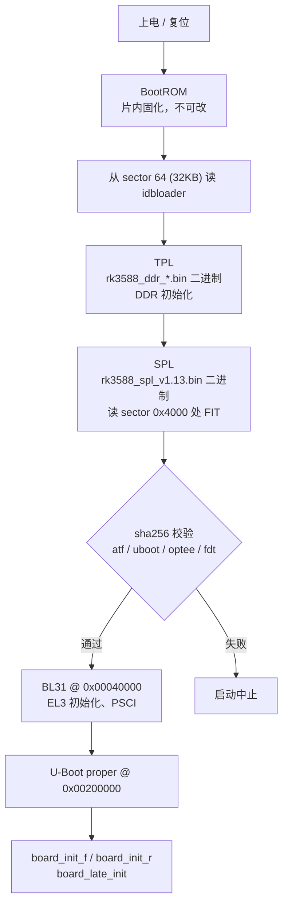
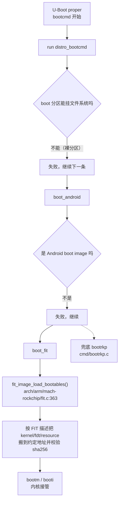
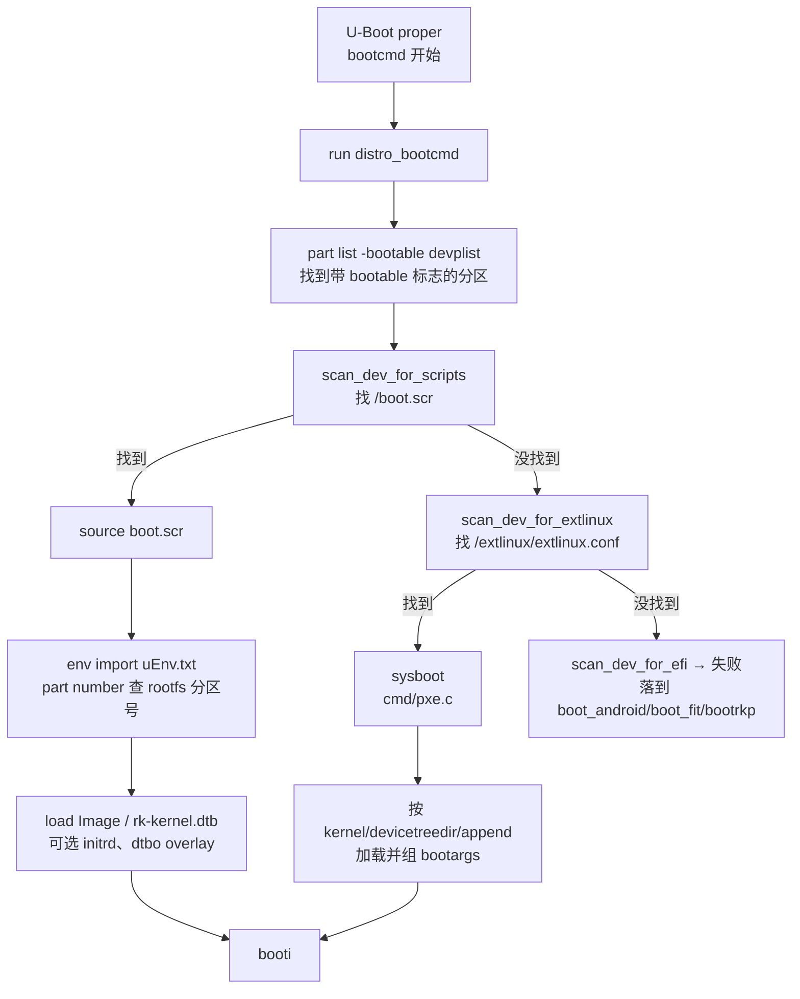

# rkboot 与 extboot：两套启动方案的完整流程

> 分析对象：`/home/dev/ljh/LubanCat_Linux_Generic_Full_SDK`
> 配套阅读：`rkboot与extboot学习笔记.md`（入门版，讲概念）；本文是进阶版，讲阶段、函数、地址和被追问时怎么答。

---

## 零、先把一个容易误解的前提说清楚

很多人以为"rkboot 方案"和"extboot 方案"是两份不同的 U-Boot 源码。不是。

这套 SDK 里**只有一份 U-Boot 源码、一份 `uboot.img`**。两种方案的区别全在 **boot 分区里装什么** 以及 **U-Boot 的 bootcmd 走哪条分支**：

- 编译 `LubanCat_rk3568_buildroot_rkboot_defconfig` → boot 分区烧一个 **FIT 裸镜像**，U-Boot 走 `boot_fit` / `bootrkp`
- 编译 `LubanCat_rk3568_buildroot_extboot_defconfig` → boot 分区烧一个 **ext2 文件系统镜像**，U-Boot 走 `distro_bootcmd`

而这两条分支的入口，是同一个宏的四行命令（`u-boot/include/configs/rockchip-common.h`）：

```c
#define RKIMG_BOOTCOMMAND                       \
    "run distro_bootcmd;"                       \
    "boot_android ${devtype} ${devnum};"        \
    "boot_fit;"                                 \
    "bootrkp;"
```

**面试点**：为什么同一份二进制能支持两种？因为它是"探测式启动"——四条命令依次尝试，谁成功谁接管，失败静默降级。这既是兼容性设计，也是排查启动问题时最该先看的地方。

---

## 一、公共前级：两种方案完全相同的四个阶段

从按下电源到 U-Boot proper 拿到控制权，这段两条路完全一样。



### 1.1 阶段表

| 阶段 | 做什么 | 代码在哪里 | 关键函数 / 文件 | 地址 |
|---|---|---|---|---|
| BootROM | 从存储介质固定偏移读 idbloader，校验后跳转 | 芯片内固化，无源码 | — | sector 64（32KB） |
| TPL | DDR 初始化、频率训练 | **闭源二进制**，来自 `rkbin/bin/rk35/rk3588_ddr_*.bin` | 由 `RKBOOT/RK3588MINIALL.ini` 的 `FlashData` 指定 | — |
| SPL | 从 sector 0x4000 读 FIT，校验、解包、跳 ATF | **闭源二进制** `rk3588_spl_v1.13.bin`（`FlashBoot`） | 源码对应 `common/spl/spl_fit.c: spl_load_simple_fit()`，但默认流程不编译它 | sector 0x4000（8MB） |
| BL31 | ARM Trusted Firmware，EL3 监控、PSCI、OP-TEE 引导 | `rkbin/bin/rk35/rk3588_bl31_v1.48.elf` | `RKTRUST/RK3588TRUST.ini` 的 `BL31_OPTION` | 0x00040000 |
| OP-TEE | 安全世界 | `rk3588_bl32_v1.19.bin` | 同上 `BL32_OPTION` | 0x08400000 |
| U-Boot proper | 外设初始化、启动介质探测、加载内核 | SDK `u-boot/` 源码 | `board.c: board_init_r → board_late_init` | 0x00200000 |

### 1.2 SPL 和 TPL 到底谁干什么（高频追问）

一句话：**TPL 把内存点亮，SPL 把 U-Boot 搬进内存。**

- **TPL（Tertiary Program Loader）**：上电时 DDR 还没初始化，CPU 只能跑在片内 SRAM。TPL 的工作就是**配置 DDR 控制器、做读写训练、把内存跑起来**。这一步对时序极其敏感，所以 Rockchip 从不公开源码，只给 `rk3588_ddr_lp4_2112MHz_lp5_2736MHz_v1.18.bin` 这样的二进制，靠文件名里的容量/频率标识来匹配硬件。
- **SPL（Secondary Program Loader）**：内存可用了，SPL 从存储介质把完整的 U-Boot（以及 ATF、OP-TEE）读进 DDR，做完整性校验，然后跳转。SPL 本身运行在很小的 SRAM 里，所以功能被砍得很厉害——没有文件系统、没有网络、只有一个精简的驱动集。

追问"为什么 idbloader 要从 sector 64 开始"：sector 0 到 63（前 32KB）留给分区表和 Rockchip 自己的头部信息（`parameter.txt`、IDB 结构），BootROM 也从固定偏移取指，所以 idbloader 必须落在 64 号扇区。这个偏移是芯片 BootROM 定的，改不了。

追问"TPL 和 SPL 都是必需的么"：在 RK3588 上是。DDR 初始化这段闭源代码只能以 TPL 形式存在（`FlashData`），SPL 才能跑在 DDR 上加载大镜像。有些小芯片（如 RV1106）会把两者合并成一个，但 RK3588 没有。

### 1.3 一个必须知道的细节：这套流程里的 SPL 是二进制的

串口第一行打印：

```
U-Boot SPL 2017.09-gc060f28d70-220414 #zyf (Apr 18 2022 - 18:13:34)
```

`#zyf` 是 Rockchip 工程师的编译标记，日期是 2022 年。也就是说 **SPL 是从 U-Boot 源码编译出来的，但以二进制形式随 rkbin 分发**，SDK 构建时并不编译它（`RK3588MINIALL.ini` 的 `FlashBoot` 直接指向 `rk3588_spl_v1.13.bin`）。

源码里的 `spl_load_simple_fit()`、`spl_mmc_load_image()` 这些函数，只有在 `./make.sh --spl` 时才会真正编进去。面试里如果被问"你们的 SPL 是自己编的么"，答"默认用 rkbin 预编译，需要时可以用 `--spl` 切换到源码编译"，这个回答比笼统说"开源"准确得多。

---

## 二、分支点：U-Boot proper 拿到控制权之后

U-Boot 起来后，`board_init_r` 完成 DM 模型初始化、外设探测，最后进 `board_late_init()`（`arch/arm/mach-rockchip/board.c:385`），然后进入主循环执行 `bootcmd`。

在 Rockchip 的 U-Boot 里，`bootcmd` 就是前面那个四段宏。这里有两个前置动作值得注意。

### 2.1 启动介质探测

`RKIMG_DET_BOOTDEV`（`include/configs/rockchip-common.h`）：

```
rkimg_bootdev=
  if mmc dev 1 && rkimgtest mmc 1; then  setenv devtype mmc; setenv devnum 1;   # SD 卡优先
elif mmc dev 0; then                      setenv devtype mmc; setenv devnum 0;   # 再试 eMMC
elif mtd_blk dev 0 ...                    # SPI NAND
elif rknand dev 0 ...                     # NAND
elif rksfc dev 0/1 ...                    # SPI NAND / SPI NOR
else                                      setenv devtype ramdisk;
```

顺序是 **SD → eMMC → SPI NAND → NAND → SPI NOR → ramdisk**。`rkimgtest` 会检查该设备 0x4000 扇区有没有合法的 Rockchip 镜像，所以插了 SD 卡不一定从 SD 启动，得卡上有东西。

`devtype`/`devnum` 会被后续所有命令引用（`${devtype} ${devnum}`），这是理解 Rockchip 启动脚本的关键：**一切寻址都建立在这两个变量上**。

### 2.2 环境变量存在哪

`.config` 里：

```
CONFIG_ENV_IS_NOWHERE=y
CONFIG_ENV_SIZE=0x8000
```

`ENV_IS_NOWHERE` 意味着**环境变量没有持久化存储**，每次上电都是编译进去的默认值，`saveenv` 会打印：

```
Saving Environment to nowhere...
```

这是面试里很好用的一问："你们的板子改了 bootargs 重启就没了，为什么？"——因为 env 没有落在任何介质上。要持久化得给它一块存储：`CONFIG_ENV_IS_IN_MMC` + 指定分区或偏移，或者在 parameter 里留一个 `env` 分区。很多量产板会在 uboot 分区尾部切一块给 env。

### 2.3 设备树的三种来源

U-Boot 运行时用的 fdt 有三条路，按优先级：

1. `INIT_KERNEL_DTB`：从介质上找内核 dtb（`arch/arm/mach-rockchip/kernel_dtb.c: init_kernel_dtb()`）
   - `LOCATE_DISTRO`：bootable 分区根目录的 `rk-kernel.dtb`
   - `LOCATE_RESOURCE`：`resource.img` 里的 dtb
   - `LOCATE_FIT`：FIT 镜像里的 fdt 节点
2. 嵌入的 `dts/kern.dtb`（`CONFIG_EMBED_KERNEL_DTB_ALWAYS=y` 时）
3. 都没有 → 保留 U-Boot 自己编译的 dtb

而且这份 dtb 还会被 `fdtgrep` 过滤——只保留带 `u-boot,dm-pre-reloc` / `u-boot,dm-spl` 标签的节点，再删掉 `pinctrl-0`、`assigned-clocks` 等属性。这就是为什么"改了 U-Boot 的 dts 却没生效"。

**这套机制的直接后果**：`USING_KERNEL_DTB=y` 时，U-Boot 里的外设（网卡、PMIC、显示）实际用的是**内核 dtb 的节点**，U-Boot 自己的 dts 只保证串口和 eMMC。做网络启动时踩的坑基本都在这里。

---

## 三、rkboot 方案：boot 分区是一个 FIT 裸镜像

### 3.1 分区布局

`device/rockchip/.chips/rk3566_rk3568/parameter-buildroot-fit.txt`：

```
uboot    4MB   @ 0x00004000
misc     4MB   @ 0x00006000
boot    64MB   @ 0x00008000     ← FIT 裸镜像
recovery 128MB @ 0x00028000
backup   32MB  @ 0x00068000
rootfs   ...   @ 0x00078000
oem      128MB @ 0x00c78000
userdata grow  @ 0x00cb8000
```

注意 **boot 分区没有 bootable 标志**。这一点决定了后面寻址方式完全不同。

### 3.2 镜像怎么来的

`device/rockchip/common/scripts/mk-kernel.sh` 的普通分支：

```sh
run_command $KMAKE "$RK_KERNEL_DTS_NAME.img"
# 若配置了 FIT：
run_command "$RK_SCRIPTS_DIR/mk-fitimage.sh" \
    "kernel/$RK_BOOT_IMG" "$RK_BOOT_FIT_ITS" \
    "$RK_KERNEL_IMG" "$RK_KERNEL_DTB" "kernel/resource.img"
```

`$RK_BOOT_FIT_ITS` 指向 `zboot.its`：

```
images {
    fdt      { data = @KERNEL_DTB@;     hash { algo = "sha256"; } }
    kernel   { data = @KERNEL_IMG@;     compression = "lz4"; hash {...} }
    resource { data = @RESOURCE_IMG@;   type = "multi"; }
};
```

`mkimage` 把这三样打成一个 FIT，加上 ATF/OP-TEE 之后就是最终的 `uboot.img`（U-Boot 自己的 FIT）和 `boot.img`（内核 FIT）。两者都放在对应分区，都是**裸数据，没有文件系统**。

### 3.3 启动流程



`boot_fit` 的实现（`cmd/bootfit.c: do_boot_fit`）：

```c
static void *do_boot_fit_storage(ulong *size)
{
    return fit_image_load_bootables(size);   /* 从存储加载整份 FIT */
}
...
fit_image_pre_process(fit);                  /* 修正 entry/load、分配 sysmem */
```

`fit_image_load_bootables()` 会解析 FIT 里的 `/images/*`，把每个镜像加载到 `load` 属性指定的地址，逐个校验哈希，最后按 `/configurations` 里的 `loadables` 决定启动顺序。

如果 `boot_fit` 也失败（比如镜像格式不对），最后兜底的是 `bootrkp`（`cmd/bootrkp.c`），它处理的是更老的 Rockchip 私有格式。这个命令是否编译进去取决于 `CONFIG_CMD_BOOT_ROCKCHIP`（见 `cmd/Makefile:30`）——SDK 的默认配置里有，一些精简过的配置里没有，串口会打印 `Unknown command 'bootrkp'`。

```c
/* 8 字节头（tag + size）+ 数据 + 4 字节 CRC32 */
ret = blk_dread(dev_desc, part->start, 1, img);
if (img->tag != TAG_KERNEL) return -EINVAL;
...
snprintf(cmdbuf, 64, "booti 0x%lx 0x%lx:0x%x 0x%lx",
         kernel_addr_r, ramdisk_addr_r, ramdisk_size, fdt_addr_r);
```

这条路径是**按分区名定点读取**：`part_get_info_by_name(dev_desc, PART_KERNEL, ...)`，kernel、boot、resource 三个分区各司其职，一个都不能少。

### 3.4 关键地址（来自实际 FIT 描述和串口日志）

| 内容 | 加载地址 | 说明 |
|---|---|---|
| BL31 (atf-1) | `0x00040000` | ATF 入口 |
| atf-2 ~ atf-4 | `0x000f0000` / `0xff100000` / `0xff001000` | BL31 附属段 |
| OP-TEE | `0x08400000` | 安全世界 |
| U-Boot proper | `0x00200000` | ATF 跳转目标 |
| U-Boot dtb (fdt) | `0x003377f0` | FIT 里的 fdt 组件 |
| 内核 dtb (kern-fdt) | `0x0033c000` | 嵌入的 kern.dtb |
| 内核 Image | `${kernel_addr_r}` = `0x00400000` | 运行时从 boot 分区读 |
| ramdisk | `${ramdisk_addr_r}` | 同上 |
| 内核 dtb（运行时） | `${fdt_addr_r}` = `0x0a100000` | 传给内核 |

注意前四个是 **SPL/ATF 阶段的固定地址**（写死在 FIT 的 `load` 属性里），后三个是 **U-Boot 运行时的环境变量**。面试里区分这两类很重要：前者由镜像打包时决定，后者可以在命令行改。

---

## 四、extboot 方案：boot 分区是一个 ext2 文件系统

### 4.1 分区布局

`parameter-extboot.txt`：

```
uboot    8MB    @ 0x00004000
boot   128MB    @ 0x00008000   bootable   ← ext2 文件系统
rootfs   grow   @ 0x00048000
```

三个变化：boot 分区翻倍到 128MB、多了 **`bootable` 标志**、misc/recovery/backup/oem 全被删掉（defconfig 里 `# RK_RECOVERY is not set`）。

`bootable` 不是装饰。U-Boot 的 distro boot 靠这条命令找启动分区：

```
part list ${devtype} ${devnum} -bootable devplist
```

没有这个标志，`devplist` 就是空的，后面所有扫描都不会发生。

### 4.2 镜像怎么来的

`mk-kernel.sh: do_build_extboot()`：

```sh
mkdir -p $EXTBOOT_DIR/{uEnv,kerneldeb,extlinux}
cp $RK_KERNEL_IMG $EXTBOOT_DIR/Image-$KERNEL_VER

echo -e "label kernel-$KERNEL_VER"                       >> extlinux/extlinux.conf
echo -e "\tkernel /Image-$KERNEL_VER"                    >> ...
echo -e "\tdevicetreedir /"                              >> ...
echo -e "\tappend root=/dev/mmcblk0p3 ..."               >> ...

cp $RK_KERNEL_DTS_DIR/*.dtb  $EXTBOOT_DTB_DIR
cp $RK_KERNEL_DTS_DIR/overlay/*.dtbo $EXTBOOT_DTB_DIR/overlay

mkimage -T script -C none -d $EXTBOOT_DIR/boot.cmd $EXTBOOT_DIR/boot.scr

truncate -s 128M $EXTBOOT_IMG
fakeroot mkfs.ext2 -F -L "boot" -d $EXTBOOT_DIR $EXTBOOT_IMG

ln -rsf "$EXTBOOT_IMG" "$RK_FIRMWARE_DIR/boot.img"
```

核心就一句：**`mkfs.ext2 -d <目录>` 把一个目录直接做成磁盘镜像**。最后那个符号链接是点睛之笔——产物文件名还叫 `boot.img`，package-file 和烧写工具完全不用改，只是内容从 FIT 变成了文件系统。

### 4.3 启动流程



扫描顺序值得单独记：`boot_prefixes="/ /boot/"`，每个前缀下先 `scan_dev_for_scripts`（找 `boot.scr`），再 `scan_dev_for_extlinux`（找 `extlinux/extlinux.conf`），最后 EFI。

**为什么 boot.scr 优先于 extlinux.conf？** 因为 bootstrap 脚本能做的事更多——它能 `env import`、能查分区号、能动态挑 dtbo。extlinux.conf 是"声明式"的，只能描述固定的加载动作。

### 4.4 设备树的供给：两份

extboot 里 DTB 有两条独立的供给路径，这点最容易漏：

1. **U-Boot 早期用的**：`CONFIG_ROCKCHIP_EARLY_DISTRO_DTB=y` + `PATH="rk-kernel.dtb"`。`rockchip_read_distro_dtb()`（`boot_rkimg.c:435`）在 distro 扫描之前就去 bootable 分区根目录读 `rk-kernel.dtb`，用于驱动模型初始化（显示、PMIC）。所以打包脚本里特意有一行 `cp ... ${RK_KERNEL_DTS_NAME}.dtb $EXTBOOT_DIR/rk-kernel.dtb`。
2. **传给内核的**：由 `extlinux.conf` 的 `devicetreedir /` 或 `boot.cmd` 里的 `load ... /rk-kernel.dtb` 决定。

两份 dtb 不一致时会出现"U-Boot 阶段显示正常、进内核黑屏"这类怪现象。面试里问"设备树是怎么传给内核的"，能答出这两条路径的差异，基本就到位了。

### 4.5 启动参数从哪来

extboot 的参数链路比 rkboot 长：

```
extlinux.conf 的 append 字段
   ↓ 或
boot.cmd: env import -t uEnv.txt  →  cmdline / uname_r / initrd
          part number ${devtype} ${devnum} "rootfs" rootfs_part
          setenv bootargs ${bootargs} root=/dev/mmcblk${devnum}p${rootfs_part} ...
   ↓
booti 时写进 /chosen/bootargs
```

注意 `part number` 这一句——它动态查 rootfs 的分区号，比 `extlinux.conf` 里写死的 `root=/dev/mmcblk0p3` 健壮：换 SD 卡启动（`mmcblk1`）时不用改配置。

**这里有个隐藏的坑**，我们调试时踩过：Rockchip U-Boot 的 `board_fdt_chosen_bootargs()`（`board.c:1054`）会把设备树里的 `/chosen/bootargs` **合并进** 环境变量，同名参数以 dtb 为准。所以 U-Boot 里 `setenv bootargs root=/dev/nfs` 可能被 dtb 里的 `root=PARTUUID=...` 顶掉。排查方法就是拿内核打印的 `Kernel command line` 和 setenv 的内容逐字对比。

---

## 五、两条路径的对比

| 维度 | rkboot | extboot |
|---|---|---|
| boot 分区格式 | FIT 裸镜像 | ext2 文件系统 |
| 寻址方式 | 按分区名取（`part_get_info_by_name`） | 按 bootable 标志扫描（`part list -bootable`） |
| 启动命令 | `boot_fit`（兜底 `bootrkp`） | `distro_bootcmd` → `boot.scr` / `sysboot` |
| 内核文件名 | 固定（打包进 FIT） | `Image-<版本>`，可多份共存 |
| 换内核 | 重新打包烧写 | 替换一个文件 + 改 uEnv.txt |
| 设备树 | `resource.img` 内的 dtb | `rk-kernel.dtb` 文件 + `devicetreedir` 自动匹配 |
| 参数来源 | FIT 里 dtb 的 chosen + env | extlinux `append` / boot.cmd 动态拼接 |
| 完整性校验 | FIT sha256 + 私有 CRC32 | 无（默认） |
| OTA / recovery | 支持（misc/recovery/backup 齐全） | 不支持（分区已裁） |
| 掉电鲁棒性 | 好（裸数据 + 校验） | 一般（ext2 无日志） |
| 启动耗时 | 短（定点读取） | 略长（扫描设备/分区/前缀） |
| 典型用途 | 量产、Android/Buildroot 出货 | 开发、Debian/Ubuntu 通用镜像 |

一句话取舍：**rkboot 为量产设计，extboot 为迭代设计**。

---

## 六、面试追问清单

按被问到的概率排序，每题给出可以直接说的要点。

**Q1：SPL 和 TPL 区别？**
TPL 做 DDR 初始化（内存还没亮，只能跑 SRAM），SPL 把 U-Boot/ATF 从存储加载到 DDR 并校验跳转。RK3588 上 TPL 只有 bin（`rk3588_ddr_*.bin`），SPL 也从 rkbin 取，除非用 `--spl` 切到源码编译。

**Q2：为什么 idbloader 在 sector 64？**
BootROM 从固定偏移读，前 32KB 留给分区表和 IDB 头。这是芯片行为，不可配置。

**Q3：FIT 是什么，和 Android boot image、Rockchip 私有头有什么区别？**
FIT 是 U-Boot 标准的容器格式，用 .its 描述、mkimage 生成，支持多镜像、压缩、哈希、签名；Android boot image 是 Google 定义的内核+ramdisk 格式；Rockchip 私有格式最简单，8 字节头 + 数据 + 4 字节 CRC32（`bootrkp.c: read_rockchip_image`）。

**Q4：`bootm`、`booti`、`bootz` 区别？**
`bootm` 处理 FIT/legacy uImage；`booti` 专门启动 arm64 的 raw Image；`bootz` 启动 arm32 的 zImage。传参顺序都是 `内核 [ramdisk] [dtb]`。

**Q5：U-Boot 怎么选择启动介质？**
`RKIMG_DET_BOOTDEV` 脚本，顺序 SD(mmcil 1) → eMMC(0) → SPI NAND → NAND → SPI NOR → ramdisk，其中 SD 会先用 `rkimgtest` 验证 0x4000 扇区有没有有效镜像。选中后设置 `devtype`/`devnum`，后续所有命令都引用这两个变量。

**Q6：extboot 为什么必须有 bootable 标志？**
distro boot 用 `part list ${devtype} ${devnum} -bootable devplist` 得到候选分区列表，没有这个标志拿不到列表，扫描直接跳过。rkboot 不需要，因为它按分区名取。

**Q7：环境变量存在哪？`saveenv` 报 "Saving Environment to nowhere" 怎么回事？**
这个 build 是 `CONFIG_ENV_IS_NOWHERE=y`，env 只存在于内存，每次上电回默认值。要持久化得配 `CONFIG_ENV_IS_IN_MMC` 并给它独立的偏移/分区。

**Q8：设备树是怎么传给内核的？**
三条路：FIT 里的 fdt 组件、resource.img 里的 dtb、boot 分区根目录的 rk-kernel.dtb（`kernel_dtb.c: dtb_scan`，顺序 DISTRO → RESOURCE → FIT）。另外 U-Boot 自己还可能需要一份早期 dtb（`EARLY_DISTRO_DTB`）用于显示/PMIC 初始化，和传给内核的那份是两回事。

**Q9：bootargs 到底谁说了算？**
U-Boot 的 `boot_prep_linux` 会写 `/chosen/bootargs`，但 Rockchip 的 `board_fdt_chosen_bootargs()` 会把**设备树里的 bootargs 合并进来，同名参数 dtb 优先**。所以改了 setenv 没效果时，先看内核打印的完整命令行。

**Q10：extboot 为什么删掉 recovery/misc？**
它放弃了 Rockchip 的 OTA/A-B 生态，用文件系统 + extlinux 的方式做开发迭代。代价是没有恢复模式和镜像级校验，量产不建议直接用。

**Q11：ext2 而不是 ext4，有什么风险？**
ext2 无日志，异常掉电可能损坏文件系统；但 boot 分区内容基本只读，写入频率低，所以野火选了更简单的 ext2（`mkfs.ext2 -d` 一步生成）。量产可以考虑 ext4 或加校验。

**Q12：为什么 `boot.scr` 优先于 `extlinux.conf`？**
扫描宏里 `scan_dev_for_scripts` 在 `scan_dev_for_extlinux` 之前。脚本能做的事更多（env import、查分区号、动态 dtb overlay），extlinux 只能声明固定动作。

**Q13：U-Boot 里 dts 改了为什么不生效？**
两遍 fdtgrep：第一遍按 `u-boot,dm-pre-reloc`/`u-boot,dm-spl` 标签裁节点，第二遍按 `OF_U_BOOT_REMOVE_PROPS` 裁属性（默认删 `pinctrl-0`、`assigned-clocks`、`clock-names`）。而且 `USING_KERNEL_DTB=y` 时运行时的外设节点来自内核 dtb，U-Boot 自己的 dts 只保证串口和 eMMC。

**Q14：怎么加快启动？**
关掉 distro boot 的无效扫描（直接 `bootcmd` 指向 `boot_fit`）、缩短 `bootdelay`、去掉 `CONFIG_CMD_*` 里用不到的命令、FIT 用 lz4 压缩（已默认）、减少环境变量里的重复探测。

**Q15：如何确认卡在哪一级？**
串口标志行：`U-Boot SPL board init` 出现说明 TPL 过了；`## Checking uboot ... + OK` 说明 FIT 校验过；`Jumping to U-Boot via ARM Trusted Firmware` 说明 ATF 起来了；`U-Boot 2017.09-...` 才是 proper 启动；再往后看 `Net:`、`Hit key to stop autoboot`。

---

## 七、调试抓手

串口日志里这几行能快速定位阶段：

| 日志 | 含义 | 卡在这说明什么 |
|---|---|---|
| `DDR Version V1.08 ...` | TPL 在跑 | DDR 参数不对会停在这或直接无输出 |
| `U-Boot SPL board init` | SPL 起来了 | 前面 TPL 成功 |
| `Trying fit image at 0x4000 sector` | SPL 找 U-Boot | 找不到会打印 `spl: partition error` |
| `## Checking uboot ... + OK` | FIT 校验通过 | 哈希不对会中止 |
| `Jumping to U-Boot via ARM Trusted Firmware` | 交给 ATF | 之后没有 U-Boot 日志说明 BL31/镜像地址有问题 |
| `U-Boot 2017.09-...` | proper 启动 | — |
| `Net: eth1: ...` | 网卡就绪 | `No ethernet found` 查 dtb |
| `Hit key to stop autoboot` | 进入 bootcmd | — |

U-Boot 命令行常用：

```
bdinfo                 # 看 DRAM、fdt 地址、reloc 信息
printenv               # 看 bootcmd、bootargs、devtype/devnum
part list mmc 0 -bootable devplist   # 看哪些分区可启动
dm tree                # 看设备绑定/probe 状态（[ + ] 才是 probe 成功）
fdt addr ${fdt_addr_r} && fdt print /chosen
```

---

## 八、源码索引

| 文件 | 内容 |
|---|---|
| `u-boot/include/configs/rockchip-common.h` | `RKIMG_BOOTCOMMAND` 四段回退链、`RKIMG_DET_BOOTDEV` 介质探测 |
| `u-boot/arch/arm/mach-rockchip/board.c` | `board_late_init`、`board_fdt_chosen_bootargs`（bootargs 合并） |
| `u-boot/arch/arm/mach-rockchip/boot_rkimg.c` | `rockchip_read_dtb_file`、`dtb_scan`、`rockchip_read_distro_dtb` |
| `u-boot/arch/arm/mach-rockchip/kernel_dtb.c` | `init_kernel_dtb`（内核 dtb 三级查找与回退） |
| `u-boot/arch/arm/mach-rockchip/fit.c` | `fit_image_load_bootables`（FIT 组件加载） |
| `u-boot/cmd/bootfit.c` | `do_boot_fit` |
| `u-boot/cmd/bootrkp.c` | `read_rockchip_image`、`boot_rockchip_image` |
| `u-boot/common/spl/spl_fit.c` | `spl_load_simple_fit`（仅在源码 SPL 流程中生效） |
| `u-boot/include/config_distro_bootcmd.h` | distro boot 扫描宏 |
| `u-boot/cmd/pxe.c` | `sysboot`（解析 extlinux.conf） |
| `u-boot/dts/Makefile` | fdtgrep 两遍过滤规则 |
| `device/rockchip/common/scripts/mk-kernel.sh` | `do_build_extboot` 打包实现 |
| `device/rockchip/.chips/rk3568/zboot.its` | rkboot 的 FIT 描述 |
| `device/rockchip/.chips/rk3568/parameter*.txt` | 两种分区布局 |
| `rkbin/RKBOOT/RK3588MINIALL.ini` | TPL/SPL 组成 |
| `rkbin/RKTRUST/RK3588TRUST.ini` | BL31/BL32 组成 |
